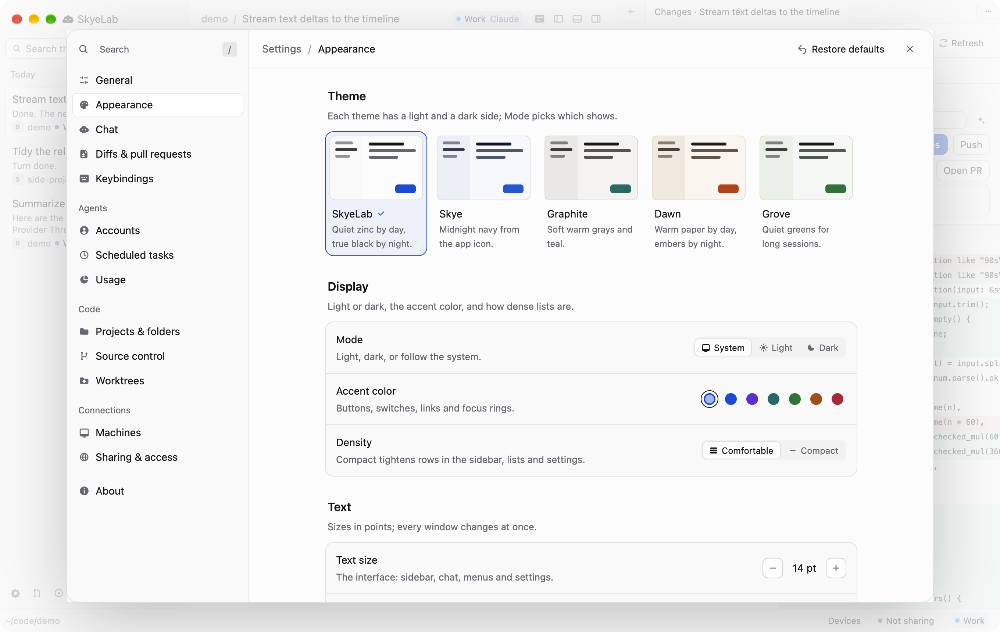

<p align="center">
  
</p>

<p align="center">
  <a href="README.md">English</a> ·
  <a href="README.zh-CN.md">简体中文</a> ·
  <a href="README.zh-TW.md">繁體中文</a> ·
  <b>日本語</b> ·
  <a href="README.ko.md">한국어</a> ·
  <a href="README.es.md">Español</a> ·
  <a href="README.pt-BR.md">Português (Brasil)</a> ·
  <a href="README.de.md">Deutsch</a> ·
  <a href="README.fr.md">Français</a> ·
  <a href="README.ru.md">Русский</a>
</p>

> これは翻訳です。正となるのは [英語版 README](README.md) です。英語版との最終同期日：2026-11-25。

<p align="center">
  <b>コーディングエージェントを動かすネイティブのデスクトップアプリ。フォルダーごとに 1 つのアカウントに固定されます。</b>
</p>

<p align="center">
  <a href="https://github.com/OpenSkye-Labs/skyelab/actions/workflows/ci.yml"></a>
  <a href="https://github.com/OpenSkye-Labs/skyelab/releases"></a>
  <a href="LICENSE"></a>
</p>

SkyeLab は Rust と [GPUI](https://www.gpui.rs/) で書かれたエージェント開発環境（ADE）です。プロジェクト上で
Claude Code と Codex のエージェントをスレッドとして動かし、その変更をレビューしながら、ターミナル、ブラウザー、
シミュレーターをすぐ横に置いておけます。全体の構成は [T3 Code](https://github.com/pingdotgg/t3code) を参考にしています。

> **ステータス：初期段階。** 粗削りな部分や破壊的変更があります。メインのプラットフォームは macOS です。

## なぜ作ったのか

仕事用と個人用のアカウントを持っていると、いずれエージェントが間違ったアカウントで動いてしまいます。SkyeLab は
それを起こり得ないものにします。**すべてのフォルダーはちょうど 1 つのアカウント（Claude または Codex）に
バインドされ、そのバインドは強制されます。**

- 仕事用リポジトリのエージェントは常に仕事用アカウントで、個人プロジェクトのエージェントは個人用アカウントで動きます。
- いちばん深いバインドが優先されるので、`~/work` をあるアカウント、`~/work/oss-fork` を別のアカウントにできます。
- バインドのないフォルダーがデフォルトのアカウントにフォールバックすることはありません。SkyeLab がまずバインドを求めます。
- バインド済みのパスが後で別の場所を指すようになった場合（シンボリックリンクの差し替えやフォルダーの移動）、
  バインドは*無効（stale）*になり、もう一度確認するまでそこではエージェントが起動しません。
- GitHub も同じです。アカウントごとに専用の `gh` ログインを持てて、コミット、プッシュ、プルリクエストに使われます。

## 機能

- **スレッド**：Claude Code と Codex に対応し、充実したタイムラインを備えます。ストリーミングされる返答と思考、
  ツールカード、インライン diff、シェル出力、ToDo リスト、サブエージェント、そしてその場で答えられる質問、
  プラン、ツールの承認。
- **コンポーザー**：ファイル、スレッド、プルリクエストへのメンションをインラインのチップとして表示し、画像やファイル、
  `/` コマンド、モデルと推論強度のピッカー、スレッドごとの権限モード、エージェント作業中のキュー、
  macOS での音声入力に対応します。
- **レビューと出荷**：行コメント付きの Changes パネル、ターンごとのチェックポイントと巻き戻し、スレッドごとの
  worktree、ブランチ、コミット、プッシュ、プルリクエスト。どれも各アカウント自身の GitHub ログインで行います。
- **コマンドパレット**（<kbd>⌘K</kbd>）：あらゆるアクションの実行、プロジェクトの切り替え、スレッドを開く
  （メッセージ内容からも検索可能）ことができます。<kbd>⌘P</kbd> でファイルを探せます。ショートカットはすべて
  割り当て直せます。
- **サイドツール**：分割できる組み込みターミナル、エージェントが操作できるブラウザーペイン、iOS シミュレーターと
  Android エミュレーター用のデバイスハブ。
- **多数のスレッドを同時に**：プロジェクトをまたいだ 1 つのリスト、スケジュールタスク、サイドチャット、1 つの
  プロンプトの複数モデルへの送信、そして他のスレッドを開始して操作するエージェント（同じアカウント内に限る）。
- **自分のマシン**：Tailscale の tailnet 経由でマシンを共有し、別のマシンからそこでスレッドを実行できます。
  モバイルクライアントは開発中です。
- **オンボーディング、テーマ、アップデート**：既存のエージェントフォルダーを取り込む初回起動ガイド、ライトと
  ダークの両方を持つ 5 つのテーマ、リリースの SHA-256 リストと照合するアプリ内アップデート。

[ユーザーガイド](docs/user-guide.md) でそれぞれを詳しく説明しています。

## スクリーンショット

<picture>
  <source media="(prefers-color-scheme: dark)" srcset="docs/images/thread-dark.png">
  
</picture>

| | |
|---|---|
| <picture><source media="(prefers-color-scheme: dark)" srcset="docs/images/composer-dark.png"></picture> | <picture><source media="(prefers-color-scheme: dark)" srcset="docs/images/palette-dark.png"></picture> |
| メンションチップとモデルピッカーのあるコンポーザー | コマンドパレット |
| <picture><source media="(prefers-color-scheme: dark)" srcset="docs/images/onboarding-dark.png"></picture> | <picture><source media="(prefers-color-scheme: dark)" srcset="docs/images/themes-dark.png"></picture> |
| 初回起動のオンボーディング | Settings → Appearance |

## インストール

[リリースページ](https://github.com/OpenSkye-Labs/skyelab/releases) から最新のビルドをダウンロードしてください。

| プラットフォーム | ファイル |
|---|---|
| macOS 14+（Apple シリコン） | `SkyeLab_0.1.1_aarch64.dmg`：開いて SkyeLab を「アプリケーション」にドラッグします。 |
| Windows（x64） | `skyelab_0.1.1_x64-setup.exe` |
| Linux（x86_64） | `skyelab_0.1.1_amd64.deb`（`sudo apt install ./skyelab_0.1.1_amd64.deb`）または `skyelab_0.1.1_x86_64.AppImage`（`chmod +x` してから実行） |

**macOS での初回起動。** リリースビルドはまだ公証を受けていないため、Gatekeeper が初回の起動をブロックします。
SkyeLab を一度開いてから、「システム設定」→「プライバシーとセキュリティ」で **Open Anyway**（このまま開く）を
クリックしてください。Windows SmartScreen でも確認されることがあります（**More info** → **Run anyway**）。
その後は、アプリ内の **Check for Updates** で最新の状態に保てます。

SkyeLab はエージェントをインストールしません。[Claude Code](https://docs.claude.com/en/docs/claude-code)（`claude`）、
Codex を使う場合は [Codex CLI](https://github.com/openai/codex)（`codex`）、プッシュとプルリクエストのために
[GitHub CLI](https://cli.github.com)（`gh`）をインストールしてください。

初回起動時、オンボーディングが既存の `~/.claude*` と `~/.codex*` フォルダーを見つけてアカウントとして追加し、
それらのエージェントが作業したプロジェクトを、確認したアカウントでそれぞれ取り込みます。残りの手順は
[はじめに](docs/getting-started.md) で説明しており、T3 Code から移ってくる場合にも役立ちます。

## ソースからビルド

最新の安定版 Rust（[rustup](https://rustup.rs)）が必要です。`rust-toolchain.toml` がそれを選びます。

- **macOS 14+：** フル版の Xcode と Metal ツールチェーン（`xcodebuild -downloadComponent MetalToolchain`）。
  これがないと、ビルドは "metal shader compilation failed" で失敗します。
- **Linux：** `libxkbcommon-x11-dev libwayland-dev libx11-xcb-dev libvulkan1 libfontconfig-dev clang cmake libwebkit2gtk-4.1-dev libgtk-3-dev`
- **Windows：** MSVC ツールチェーン。

```sh
cargo run -p skyelab-app                              # run a debug build
cargo install cargo-packager --locked                 # or build the macOS app and disk image:
cargo packager --release -p skyelab-app -f app,dmg    # writes target/release/SkyeLab.app and a .dmg
```

## ドキュメント

- [はじめに](docs/getting-started.md)：インストール、アカウント、バインド、セッションの取り込み、日々の流れ。
- [ユーザーガイド](docs/user-guide.md)：すべての機能をページごとに。
- [セキュリティモデル](docs/security.md)：SkyeLab が何を保証し、どう保証するか。
- [アーキテクチャ](docs/architecture.md)：クレート、プロセス内デーモン、設計判断とロードマップ。
- [モバイル](docs/mobile.md)：iOS と Android のクライアント。
- [変更履歴](CHANGELOG.md)

| プラットフォーム | ステータス |
|---|---|
| macOS 14+（Apple シリコン） | メイン。毎日使用・テストしています。 |
| Windows、Linux | CI でビルドとテストを実施。手動でのテストは少なめです。 |
| iOS、Android | リモートクライアントを [`mobile/`](mobile) で開発中。 |

## コントリビュート

コントリビュートを歓迎します。[CONTRIBUTING.md](CONTRIBUTING.md) では、セットアップ、すべての変更が通るべき
チェック、実際のアカウントを使わずに UI の変更をテストする方法、そして
[翻訳版 README の更新方法](CONTRIBUTING.md#translated-readmes) を説明しています。
[行動規範](CODE_OF_CONDUCT.md) に従ってください。質問は
[Discussions](https://github.com/OpenSkye-Labs/skyelab/discussions) へどうぞ。

## セキュリティ

セキュリティ上の問題を見つけましたか？ [SECURITY.md](SECURITY.md) に書かれた方法で非公開で報告してください。
公開の issue は立てないでください。

## ライセンス

[MIT](LICENSE)。このプロジェクトが踏襲しているデザインについて、[T3 Code](https://github.com/pingdotgg/t3code)（MIT）に感謝します。
