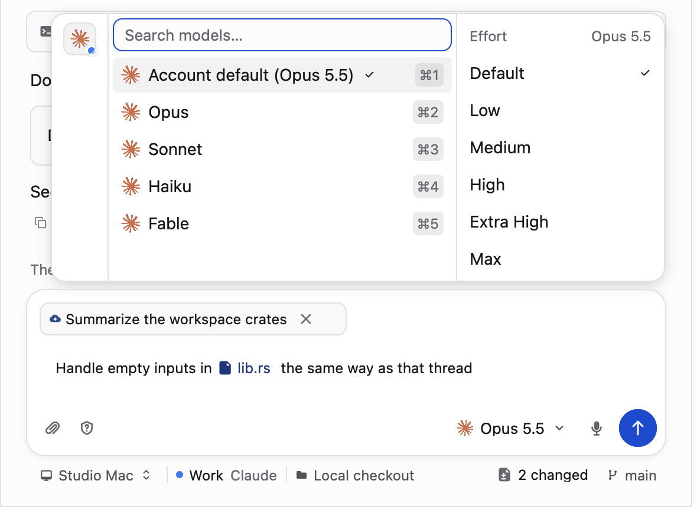

<p align="center">
  
</p>

<p align="center">
  <a href="README.md">English</a> ·
  <a href="README.zh-CN.md">简体中文</a> ·
  <a href="README.zh-TW.md">繁體中文</a> ·
  <a href="README.ja.md">日本語</a> ·
  <b>한국어</b> ·
  <a href="README.es.md">Español</a> ·
  <a href="README.pt-BR.md">Português (Brasil)</a> ·
  <a href="README.de.md">Deutsch</a> ·
  <a href="README.fr.md">Français</a> ·
  <a href="README.ru.md">Русский</a>
</p>

> 이 문서는 번역본입니다. 기준 문서는 [영문 README](README.md)이며, 2026-11-25에 마지막으로 동기화했습니다.

<p align="center">
  <b>모든 폴더가 하나의 계정에 고정되는, 코딩 에이전트를 실행하기 위한 네이티브 데스크톱 앱입니다.</b>
</p>

<p align="center">
  <a href="https://github.com/OpenSkye-Labs/skyelab/actions/workflows/ci.yml"></a>
  <a href="https://github.com/OpenSkye-Labs/skyelab/releases"></a>
  <a href="LICENSE"></a>
</p>

SkyeLab은 Rust와 [GPUI](https://www.gpui.rs/)로 작성된 에이전틱 개발 환경(ADE)입니다. 프로젝트별 스레드에서
Claude Code와 Codex 에이전트를 실행하고, 에이전트가 바꾼 내용을 검토하며, 터미널과 브라우저, 시뮬레이터를
바로 옆에 띄워 둘 수 있습니다. 전체적인 형태는 [T3 Code](https://github.com/pingdotgg/t3code)에서 가져왔습니다.

> **상태: 초기 단계.** 거친 부분과 호환성을 깨는 변경이 있을 수 있습니다. 주 플랫폼은 macOS입니다.

## 만든 이유

업무용 계정과 개인 계정을 함께 쓰다 보면, 언젠가는 에이전트가 엉뚱한 계정으로 실행됩니다. SkyeLab은
그런 일이 생길 수 없게 합니다: **모든 폴더는 정확히 하나의 계정(Claude 또는 Codex)에 바인딩되고, 이 바인딩은 강제됩니다.**

- 업무 저장소의 에이전트는 항상 업무 계정으로, 사이드 프로젝트의 에이전트는 개인 계정으로 실행됩니다.
- 가장 깊은 바인딩이 우선하므로 `~/work`는 한 계정에, `~/work/oss-fork`는 다른 계정에 둘 수 있습니다.
- 바인딩이 없는 폴더는 절대 기본 계정으로 대체되지 않습니다. SkyeLab이 먼저 바인딩하라고 요청합니다.
- 바인딩된 경로가 나중에 다른 곳을 가리키게 되면(심볼릭 링크가 바뀌었거나 폴더가 옮겨진 경우) 바인딩은
  *stale* 상태가 되고, 다시 확인할 때까지 그곳에서는 어떤 에이전트도 시작되지 않습니다.
- GitHub도 같은 방식입니다: 계정마다 자체 `gh` 로그인을 둘 수 있고, 커밋, 푸시, 풀 리퀘스트에 그 로그인을 씁니다.

## 기능

- Claude Code와 Codex용 **스레드**와 풍부한 타임라인: 스트리밍되는 답변과 사고 과정, 도구 카드, 인라인
  diff, 셸 출력, 할 일 목록, 서브에이전트, 그리고 그 자리에서 답하는 질문, 계획, 도구 승인.
- **작성기(Composer)**: 파일, 스레드, 풀 리퀘스트 멘션을 인라인 칩으로 넣고, 이미지와 파일, `/` 명령,
  모델과 effort 선택기, 스레드별 권한 모드, 에이전트가 일하는 동안 쓰는 대기열, macOS 받아쓰기를 지원합니다.
- **검토와 배포**: 줄 단위 코멘트가 있는 Changes 패널, 턴별 체크포인트와 되감기, 스레드별 워크트리,
  브랜치, 커밋, 푸시, 그리고 계정마다 자체 GitHub 로그인으로 만드는 풀 리퀘스트.
- **명령 팔레트**(<kbd>⌘K</kbd>): 어떤 동작이든 실행하고, 프로젝트를 전환하거나 스레드를 엽니다(메시지
  내용으로도 찾을 수 있습니다). <kbd>⌘P</kbd>로 파일을 찾습니다. 모든 단축키는 다시 지정할 수 있습니다.
- **보조 도구**: 분할을 지원하는 내장 터미널, 에이전트가 조작할 수 있는 브라우저 패널, iOS 시뮬레이터와
  Android 에뮬레이터를 위한 디바이스 허브.
- **여러 스레드를 동시에**: 프로젝트를 아우르는 하나의 목록, 예약 작업, 사이드 채팅, 하나의 프롬프트를 여러
  모델에 보내기, 다른 스레드를 시작하고 조작하는 에이전트(같은 계정 안에서만).
- **내 머신들**: Tailscale tailnet으로 머신을 공유하고, 다른 머신에서 그 위에 스레드를 실행합니다. 모바일
  클라이언트는 개발 중입니다.
- **온보딩, 테마, 업데이트**: 기존 에이전트 폴더를 가져오는 첫 실행 가이드, 라이트와 다크 버전이 있는
  다섯 가지 테마, 릴리스의 SHA-256 목록으로 검증하는 앱 내 업데이트.

각 기능은 [사용자 가이드](docs/user-guide.md)에서 자세히 다룹니다.

## 스크린샷

<picture>
  <source media="(prefers-color-scheme: dark)" srcset="docs/images/thread-dark.png">
  
</picture>

| | |
|---|---|
| <picture><source media="(prefers-color-scheme: dark)" srcset="docs/images/composer-dark.png"></picture> | <picture><source media="(prefers-color-scheme: dark)" srcset="docs/images/palette-dark.png"></picture> |
| 멘션 칩과 모델 선택기가 있는 작성기 | 명령 팔레트 |
| <picture><source media="(prefers-color-scheme: dark)" srcset="docs/images/onboarding-dark.png"></picture> | <picture><source media="(prefers-color-scheme: dark)" srcset="docs/images/themes-dark.png"></picture> |
| 첫 실행 온보딩 | Settings → Appearance |

## 설치

[릴리스 페이지](https://github.com/OpenSkye-Labs/skyelab/releases)에서 최신 빌드를 내려받으세요:

| 플랫폼 | 파일 |
|---|---|
| macOS 14+ (Apple silicon) | `SkyeLab_<version>_aarch64.dmg`: 열고 SkyeLab을 Applications로 드래그합니다. |
| Windows (x64) | `skyelab_<version>_x64-setup.exe` |
| Linux (x86_64) | `skyelab_<version>_amd64.deb` (`sudo apt install ./skyelab_<version>_amd64.deb`) 또는 `skyelab_<version>_x86_64.AppImage` (`chmod +x` 후 실행) |

**macOS에서 처음 열 때.** 릴리스 빌드는 아직 공증(notarize)되지 않아서 Gatekeeper가 첫 실행을 막습니다. SkyeLab을
한 번 연 다음, System Settings → Privacy & Security로 가서 **Open Anyway**를 클릭하세요. Windows SmartScreen도
물어볼 수 있습니다(**More info** → **Run anyway**). 그 후로는 앱의 **Check for Updates**로 최신 상태를 유지합니다.

SkyeLab은 에이전트를 설치하지 않습니다. [Claude Code](https://docs.claude.com/en/docs/claude-code)(`claude`)를 설치하고,
Codex를 쓴다면 [Codex CLI](https://github.com/openai/codex)(`codex`)를, 푸시와 풀 리퀘스트를 위해
[GitHub CLI](https://cli.github.com)(`gh`)를 설치하세요.

처음 시작하면 온보딩이 기존 `~/.claude*`와 `~/.codex*` 폴더를 찾아 계정으로 추가하고, 그 에이전트들이 작업한
프로젝트를 각각 확인한 계정으로 가져옵니다. 나머지는 [시작하기](docs/getting-started.md)에서 안내하며,
T3 Code에서 넘어오는 경우에도 도움이 됩니다.

## 소스에서 빌드

최신 안정 버전 Rust([rustup](https://rustup.rs))가 필요합니다. `rust-toolchain.toml`이 버전을 골라 줍니다.

- **macOS 14+:** 전체 Xcode와 Metal 툴체인(`xcodebuild -downloadComponent MetalToolchain`). 없으면
  "metal shader compilation failed"로 빌드가 실패합니다.
- **Linux:** `libxkbcommon-x11-dev libwayland-dev libx11-xcb-dev libvulkan1 libfontconfig-dev clang cmake libwebkit2gtk-4.1-dev libgtk-3-dev`
- **Windows:** MSVC 툴체인.

```sh
cargo run -p skyelab-app                              # run a debug build
cargo install cargo-packager --locked                 # or build the macOS app and disk image:
cargo packager --release -p skyelab-app -f app,dmg    # writes target/release/SkyeLab.app and a .dmg
```

## 문서

- [시작하기](docs/getting-started.md): 설치, 계정, 바인딩, 세션 가져오기, 일상적인 작업 흐름.
- [일상 설정, T3 Code에서 옮겨 오기](docs/user-guide-daily-setup.md): 일상 작업을 옮기는 짧은 체크리스트.
- [사용자 가이드](docs/user-guide.md): 모든 기능을 페이지별로.
- [보안 모델](docs/security.md): SkyeLab이 무엇을 어떻게 보장하는지.
- [아키텍처](docs/architecture.md): 크레이트, 프로세스 내 데몬, 결정 사항과 로드맵.
- [모바일](docs/mobile.md): iOS와 Android 클라이언트.
- [변경 기록](CHANGELOG.md)

| 플랫폼 | 상태 |
|---|---|
| macOS 14+ (Apple silicon) | 주 플랫폼. 매일 사용하고 테스트합니다. |
| Windows, Linux | CI에서 빌드하고 테스트합니다. 직접 테스트는 덜 합니다. |
| iOS, Android | 원격 클라이언트가 [`mobile/`](mobile)에서 개발 중입니다. |

## 기여하기

기여를 환영합니다. [CONTRIBUTING.md](CONTRIBUTING.md)에서 환경 설정, 모든 변경이 통과해야 하는 검사,
실제 계정 없이 UI 변경을 테스트하는 방법, 그리고 [번역된 README를 갱신하는 방법](CONTRIBUTING.md#translated-readmes)을 다룹니다.
[행동 강령](CODE_OF_CONDUCT.md)을 지켜 주세요. 질문은
[Discussions](https://github.com/OpenSkye-Labs/skyelab/discussions)에 올려 주세요.

## 보안

보안 문제를 발견했나요? [SECURITY.md](SECURITY.md)에 설명된 대로 비공개로 제보해 주세요. 공개 이슈는 열지 마세요.

## 라이선스

[MIT](LICENSE). 이 프로젝트가 따르는 디자인을 제공한 [T3 Code](https://github.com/pingdotgg/t3code)(MIT)에 감사드립니다.
