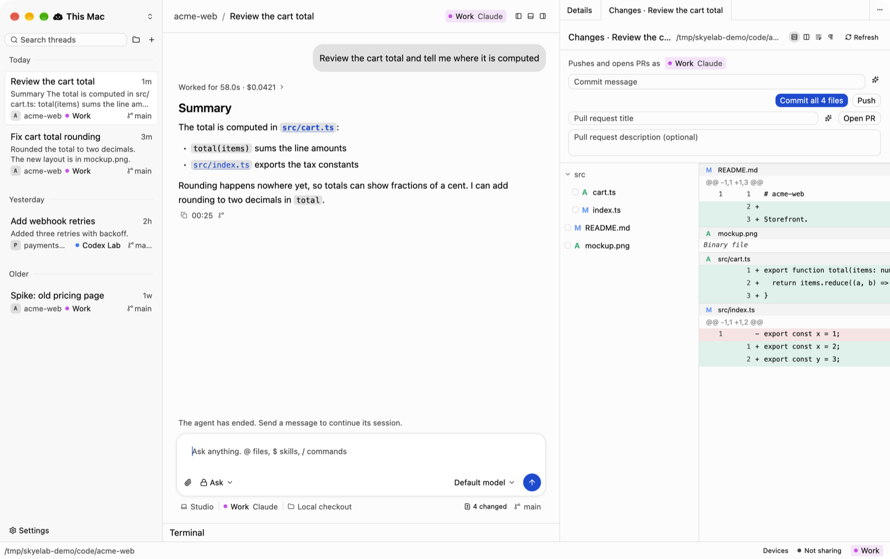
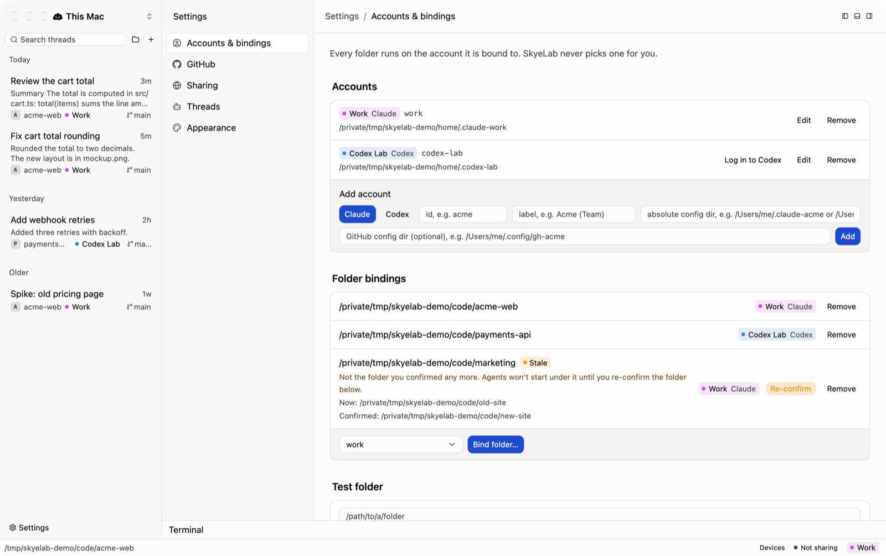

#  SkyeLab

SkyeLab is a native agentic development environment (ADE) written in Rust with [GPUI](https://www.gpui.rs/).
You run Claude Code agents in threads over your projects, review their changes, and keep a terminal, a browser
preview and your simulators next to them. It is inspired by [T3 Code](https://github.com/pingdotgg/t3code) and
borrows its overall shape.

**Why it exists: every folder is bound to exactly one account (Claude or Codex), and SkyeLab enforces it.** An agent in your
work repo always runs on the work account, and one in a side project always runs on your personal account. A folder
with no binding doesn't fall back to a default. SkyeLab asks you to bind it first.

> **Status: early, pre-release.** Expect rough edges and breaking changes. macOS is the main platform.



## Features

What's built today:

- **Account bindings.** Add Claude accounts (one `CLAUDE_CONFIG_DIR` each) or OpenAI Codex accounts (one
  `CODEX_HOME` each) and bind folders to them in Settings. The folder decides both the account and the agent.
  The deepest binding wins. Each binding remembers the real folder you confirmed, so if the path later points
  somewhere else (a swapped symlink, a moved folder), it turns *stale* and no agent starts there until you re-confirm.
- **One thread list.** The sidebar lists every project's threads together (pinned, working, then Today, Yesterday,
  Previous 7 days and Older), each row with the agent's last reply, its project, state (with a running timer while it works), branch, pull
  request and the account its folder is bound to; hovering a row shows where it runs, on which account and binding. A project filter narrows it, and New thread asks
  which project when it can't tell.
- **Projects and threads.** Each thread runs the `claude` CLI in stream-json mode, or `codex app-server` for a Codex
  account, streams its text and thinking as they arrive, shows tool calls as cards (inline edit diffs, shell
  commands with their output, a live todo list, answerable questions and plans, subagent cards), folds a finished
  turn's work under **Worked for …**, lists the files each turn changed, shows a failed turn's error with Retry, finds
  text with <kbd>⌘F</kbd>, and saves the conversation to a
  local SQLite database (complete messages; streamed partial text is shown, not saved).
  Reopening a thread resumes the same session. The thread header names the provider. Rename, pin, archive or delete
  threads (with undo), search them by title and message text, see which ones finished while you were away (unread
  markers and notifications), and move between them with <kbd>⌘N</kbd>, <kbd>⇧⌘[</kbd> / <kbd>⇧⌘]</kbd> and
  <kbd>⌘1</kbd>–<kbd>⌘9</kbd>. <kbd>⌘O</kbd> opens the folder in your editor. The header is a plain breadcrumb;
  the right panel's **Details** tab holds the folder, branch, git actions, scripts, delegated agents, pull request
  and editor, plus every account's latest usage reading. Dialogs dim the window behind them.
- **GitHub per account.** An account can have its own `gh` config dir (`GH_CONFIG_DIR`). Agents, project terminals
  and the Changes tab's Commit / Push / Open PR all run as that account's GitHub user; inherited `GH_TOKEN` /
  `GITHUB_TOKEN` never pass through. Push accepts https remotes (credentials bound per account) and refuses ssh.
- **Composer.** Attach images and files (paperclip, drag or paste), mention tracked files with `@`, run commands with
  `/` and skills with `$`, and pick the model and effort and the permission mode per thread from two small chips. A message sent while the agent works queues
  until the turn ends; **Steer** sends it in now. The strip under it shows the machine, account, checkout, changed
  files and branch.
- **Worktrees and diff review.** Switch "Local checkout" to "New worktree" under the composer and the thread gets its own git worktree on a
  `skyelab/<slug>` branch. The Changes tab, in the right panel beside the thread, shows a coloured diff of what the agent did, and you can discard the worktree.
- **Command palette.** <kbd>⌘K</kbd> / <kbd>⇧⌘P</kbd> (<kbd>Ctrl</kbd> on Linux and Windows) finds and runs any action,
  switches project, opens a thread (also found by its messages, in any project) or goes to a terminal, Changes or
  browser tab.
- **Branches, checkpoints and scripts.** A branch picker in the Details tab (switch, create, and stash or carry
  changes), a base branch for new worktrees, a checkpoint per agent turn with "Turn N" diffs and "Rewind to before
  turn N", and per-project scripts (run from the card or the palette) with setup scripts for new worktrees.
- **Terminal.** An embedded terminal panel (`alacritty_terminal`), opened in the project or worktree folder.
- **Browser preview.** A browser tab for your dev server. Agents can open their own tab and navigate it, read its
  URL, evaluate JavaScript in it and take a screenshot of it (http and https only, localhost included; screenshots
  on macOS only). The tab says an agent controls it;
  **Take over** detaches the agent. An agent never reaches a tab you opened or another thread's, and its tab keeps
  its own cookies and storage. macOS and Linux only (like delegation).
- **Device hub.** Lists iOS Simulators and Android emulators. Boot, shut down, take screenshots, open URLs and
  install apps.
- **Share a machine over your tailnet.** Off by default. When on, the app serves this machine over `wss://` with its
  Tailscale HTTPS certificate, and only your own, untagged devices may connect, each one after you allow it once
  (matching a code shown on both screens). Revoke cuts a device off at once.
- **Environment switcher.** Pick another of your machines at the top of the sidebar to see its projects and threads,
  start threads there and send follow-ups. Its agents run there, on its own accounts.
- **Mobile client (in progress).** An iOS and Android app in GPUI under [`mobile/`](mobile). It connects to a
  shared machine over your tailnet (`*.ts.net` names, `wss://`), lists projects and threads, streams a thread live,
  sends or stops, and answers the agent's permission requests. Not packaged for distribution yet.
- **Agent orchestration.** An agent can start and drive other threads through SkyeLab's own MCP tools, only in
  projects bound to its own account. A child's breadcrumb links its parent, and the parent's Details tab lists its
  delegated threads under Lineage, with their status. macOS and Linux only for now.

- **Tool approvals in the thread.** When an agent needs permission for a tool (a command, an edit), the thread shows
  what it wants to run and waits: **Allow once**, **Allow for this thread** or **Deny**. Each thread has a
  permission mode (Ask, Plan, Accept edits, Full access, the last behind a confirm). Phones and other machines viewing
  the thread can answer too. When a turn fails or the agent exits with an error, its stderr shows as an
  **Agent output** row.

Not built yet: agents beyond Claude Code and Codex, and delegation to other machines.

| Changes tab | Accounts and bindings | Device hub |
|---|---|---|
|  |  |  |

## Quick start

### 1. Platform setup

You need the latest stable Rust ([rustup](https://rustup.rs)); `rust-toolchain.toml` picks it. You also need
[Claude Code](https://docs.claude.com/en/docs/claude-code) installed, with `claude` on your `PATH`, and for Codex
accounts the [Codex CLI](https://github.com/openai/codex) (`codex` on your `PATH`).

- **macOS 14 or later:** full Xcode plus the Metal toolchain:
  `xcodebuild -downloadComponent MetalToolchain`. Without it the build fails with "metal shader compilation failed".
- **Linux:** `libxkbcommon-x11-dev libwayland-dev libx11-xcb-dev libvulkan1 libfontconfig-dev clang cmake libwebkit2gtk-4.1-dev libgtk-3-dev`
- **Windows:** the MSVC toolchain, nothing else.

### 2. Run it

```sh
cargo run -p skyelab-app
```

### 3. Set up accounts

Sign in to each Claude account in its own config folder:

```sh
CLAUDE_CONFIG_DIR=~/.claude-work claude auth login
CLAUDE_CONFIG_DIR=~/.claude claude auth login
```

For a Codex account, add it in Settings with **Codex** picked and press **Log in to Codex**, or run
`CODEX_HOME=~/.codex-work codex login` yourself.

Then open Settings (<kbd>⌘,</kbd>, or <kbd>Ctrl+,</kbd> on Linux and Windows), add each account with its config
folder, and bind your project folders to them. The [user guide](docs/user-guide.md) covers the rest.

## Architecture

The desktop app hosts an environment daemon in-process. Clients (this window, another machine's window, the mobile
app) talk to it over a WebSocket protocol. Details, decisions and the roadmap are in
[docs/architecture.md](docs/architecture.md).

| Crate | What it holds |
|---|---|
| `skyelab-core` | Accounts, bindings and app settings. No GPUI, unit-tested without a window. |
| `skyelab-app` | The GPUI desktop app (binary `skyelab`). |
| `skyelab-agent` | Launches `claude` (stream-json) or `codex app-server` with the bound account and maps both onto one event stream. |
| `skyelab-store` | SQLite storage for projects, threads and thread events. |
| `skyelab-git` | Git status, diffs, worktrees, branches and per-turn checkpoints. |
| `skyelab-terminal` | PTY terminal and its GPUI view. |
| `skyelab-browser` | The webview browser tab. |
| `skyelab-devices` | iOS Simulator and Android emulator control (`simctl`, `adb`, `emulator`). |
| `skyelab-protocol` | The RPC messages between clients and the daemon. |
| `skyelab-daemon` | The environment server and its tailnet connection gate. |
| `skyelab-client` | The client side of the protocol, used by the environment switcher and the mobile app. |
| `skyelab-tailnet` | Talks to the installed Tailscale: this node, peers, `whois`, certificates. |

## Security model

- **Account invariant.** A folder resolves to its account or to nothing. There is never a default account. An
  unknown account id in `accounts.toml` is a load error.
- **Clean environment, one allowlist.** Each agent starts with an empty environment. A short allowlist passes
  through (`PATH`, `HOME`, locale, proxy and CA settings, and the like), and then SkyeLab sets `CLAUDE_CONFIG_DIR`
  or `CODEX_HOME` for the bound account. Nothing that could pick another account, provider or API base URL
  (`ANTHROPIC_*`, `CLAUDE_CODE_*`, `OPENAI_*`, `CODEX_*`, `GH_TOKEN`, `AWS_*`, the parent's own homes) is inherited.
  Project terminals and every git/gh call SkyeLab runs use the same list (terminals add shell vars such as
  `EDITOR`, `PAGER` and `SSH_AUTH_SOCK`). An agent's own `git push` asks only the account's `gh` for https
  credentials, and gets no ssh-agent unless the account sets `ssh_agent = true`.
- **Project settings don't load.** Agents run with `--setting-sources user --strict-mcp-config`, so a cloned repo's
  `.claude/settings*.json` and `.mcp.json` can't redirect credentials or run hooks. Codex runs with the folder and
  every folder above it (and a worktree's main repo) marked untrusted, so a repo's `.codex/config.toml`, hooks and
  `.rules` never load. Codex keeps its `workspace-write` sandbox (writes stay in the folder, no network) unless a
  thread picks Plan (read-only) or Full access, and its approval requests come to the thread.
- **Approvals stay with you.** An agent's permission ask waits in its thread until you answer it there, or from
  a device you approved for sharing. "Allow for this thread" lasts while that agent runs, and is never written to
  the project's or your Claude settings. Full access asks before it turns on.
- **Delegation stays on one account.** An agent can start threads only in projects bound to its own account, and can
  read or message only the threads it started. Its tools reach SkyeLab over a private socket with a one-use token.
- **Tailnet trust.** Sharing listens only on this machine's tailnet addresses and serves only TLS 1.3 with the
  machine's own Tailscale certificate. Each connection must come from one of your own, untagged devices (checked
  with `tailscale whois`), and carry a device key you approved on this machine for that device (kept in the
  macOS keychain by release builds on a Mac). Browser pages (any `Origin` header) are refused. A connected device can list and drive
  threads, but can't add projects, change accounts or bindings, or open terminals. The client checks the
  certificate against the exact MagicDNS name it dialled, and the desktop app also asks its own Tailscale who it
  dialled: only your own untagged devices, and the same Tailscale node it saw for that name before. The phone
  remembers the node too, but only from what the machine says about itself (it has no Tailscale CLI to ask).

The full rules are in [docs/remote.md](docs/remote.md) and [docs/decisions.md](docs/decisions.md).

## Platform support

| Platform | Status |
|---|---|
| macOS 14+ (Apple silicon) | Primary. Used and tested daily. |
| Windows | Builds and passes tests in CI. Less tested by hand. |
| Linux | Builds and passes tests in CI. Less tested by hand. |
| iOS, Android | Remote client in progress under [`mobile/`](mobile). See [docs/mobile.md](docs/mobile.md). |

## Contributing

Read [CLAUDE.md](CLAUDE.md) first. It holds the rules this repo is built with: the accounts invariant, Rust and
error-handling rules, and the GPUI rules in [docs/gpui.md](docs/gpui.md). Every change goes through the `/loop`
workflow (plan, build, verify, review), and done means all three pass:

```sh
cargo fmt --check
cargo clippy --workspace --all-targets -- -D warnings
cargo test --workspace
```

## License

[MIT](LICENSE). Credit to [T3 Code](https://github.com/pingdotgg/t3code) (MIT) for the design this follows.
