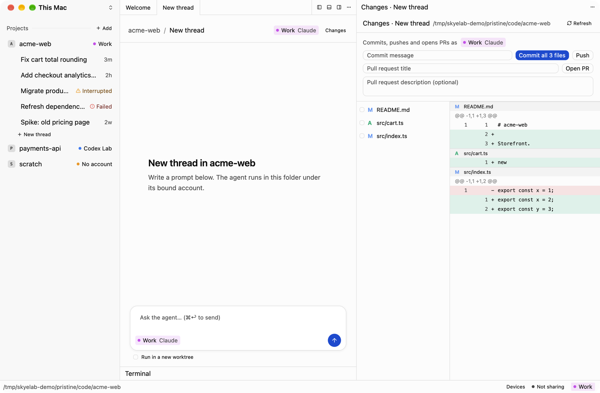
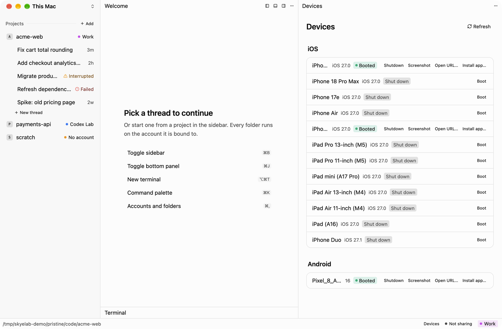

# SkyeLab

SkyeLab is a native agentic development environment (ADE) written in Rust with [GPUI](https://www.gpui.rs/).
You run Claude Code agents in threads over your projects, review their changes, and keep a terminal, a browser
preview and your simulators next to them. It is inspired by [T3 Code](https://github.com/pingdotgg/t3code) and
borrows its overall shape.

**Why it exists: every folder is bound to exactly one Claude account, and SkyeLab enforces it.** An agent in your
work repo always runs on the work account, and one in a side project always runs on your personal account. A folder
with no binding doesn't fall back to a default. SkyeLab asks you to bind it first.

> **Status: early, pre-release.** Expect rough edges and breaking changes. macOS is the main platform.


## Features

What's built today:

- **Account bindings.** Add Claude accounts (one `CLAUDE_CONFIG_DIR` each) and bind folders to them in Settings.
  The deepest binding wins. Each binding remembers the real folder you confirmed, so if the path later points
  somewhere else (a swapped symlink, a moved folder), it turns *stale* and no agent starts there until you re-confirm.
- **Projects and threads.** Each thread runs the `claude` CLI in stream-json mode, renders its messages and tool calls
  as they arrive, and saves everything to a local SQLite database. Reopening a thread resumes the same Claude session.
- **GitHub per account.** An account can have its own `gh` config dir (`GH_CONFIG_DIR`). Agents, project terminals
  and the Changes tab's Commit / Push / Open PR all run as that account's GitHub user; inherited `GH_TOKEN` /
  `GITHUB_TOKEN` never pass through. Push accepts https remotes (credentials bound per account) and refuses ssh.
- **Worktrees and diff review.** Tick "Run in a new worktree" and the thread gets its own git worktree on a
  `skyelab/<slug>` branch. The Changes tab shows a coloured diff of what the agent did, and you can discard the worktree.
- **Command palette.** <kbd>⌘K</kbd> / <kbd>⇧⌘P</kbd> (<kbd>Ctrl</kbd> on Linux and Windows) finds and runs any action,
  switches project, opens a thread or goes to an open tab.
- **Terminal.** An embedded terminal panel (`alacritty_terminal`), opened in the project or worktree folder.
- **Browser preview.** A browser tab for your dev server. Agents can open their own tab and navigate it, read its
  URL and evaluate JavaScript in it (http and https only, localhost included). The tab says an agent controls it;
  **Take over** detaches the agent. An agent never reaches a tab you opened or another thread's. No screenshots yet.
- **Device hub.** Lists iOS Simulators and Android emulators. Boot, shut down, take screenshots, open URLs and
  install apps.
- **Share a machine over your tailnet.** Off by default. When on, the app serves this machine over `wss://` with its
  Tailscale HTTPS certificate, and only your own, untagged devices may connect.
- **Environment switcher.** Pick another of your machines at the top of the sidebar to see its projects and threads,
  start threads there and send follow-ups. Its agents run there, on its own accounts.
- **Mobile client (in progress).** An iOS and Android app in GPUI under [`mobile/`](mobile). It connects to a
  shared machine over your tailnet (`*.ts.net` names, `wss://`), lists projects and threads, streams a thread live,
  and sends or stops. Not packaged for distribution yet.
- **Agent orchestration.** An agent can start and drive other threads through SkyeLab's own MCP tools, only in
  projects bound to its own account. A child shows "Delegated by" its parent, and the parent lists its delegated
  threads. macOS and Linux only for now.

Not built yet: other agents such as Codex, and delegation to other machines.

| Changes tab | Accounts and bindings | Device hub |
|---|---|---|
|  |  |  |

## Quick start

### 1. Platform setup

You need the latest stable Rust ([rustup](https://rustup.rs)); `rust-toolchain.toml` picks it. You also need
[Claude Code](https://docs.claude.com/en/docs/claude-code) installed, with `claude` on your `PATH`.

- **macOS 14 or later:** full Xcode plus the Metal toolchain:
  `xcodebuild -downloadComponent MetalToolchain`. Without it the build fails with "metal shader compilation failed".
- **Linux:** `libxkbcommon-x11-dev libwayland-dev libx11-xcb-dev libvulkan1 libfontconfig-dev clang cmake libwebkit2gtk-4.1-dev libgtk-3-dev`
- **Windows:** the MSVC toolchain, nothing else.

### 2. Run it

```sh
cargo run -p skyelab-app
```

### 3. Set up accounts

Sign in to each Claude account in its own config folder:

```sh
CLAUDE_CONFIG_DIR=~/.claude-work claude auth login
CLAUDE_CONFIG_DIR=~/.claude claude auth login
```

Then open Settings (<kbd>⌘,</kbd>, or <kbd>Ctrl+,</kbd> on Linux and Windows), add each account with its config
folder, and bind your project folders to them. The [user guide](docs/user-guide.md) covers the rest.

## Architecture

The desktop app hosts an environment daemon in-process. Clients (this window, another machine's window, the mobile
app) talk to it over a WebSocket protocol. Details, decisions and the roadmap are in
[docs/architecture.md](docs/architecture.md).

| Crate | What it holds |
|---|---|
| `skyelab-core` | Accounts, bindings and app settings. No GPUI, unit-tested without a window. |
| `skyelab-app` | The GPUI desktop app (binary `skyelab`). |
| `skyelab-agent` | Launches `claude` with the bound account and parses its stream-json output. |
| `skyelab-store` | SQLite storage for projects, threads and thread events. |
| `skyelab-git` | Git status, diffs and worktrees. |
| `skyelab-terminal` | PTY terminal and its GPUI view. |
| `skyelab-browser` | The webview browser tab. |
| `skyelab-devices` | iOS Simulator and Android emulator control (`simctl`, `adb`, `emulator`). |
| `skyelab-protocol` | The RPC messages between clients and the daemon. |
| `skyelab-daemon` | The environment server and its tailnet connection gate. |
| `skyelab-client` | The client side of the protocol, used by the environment switcher and the mobile app. |
| `skyelab-tailnet` | Talks to the installed Tailscale: this node, peers, `whois`, certificates. |

## Security model

- **Account invariant.** A folder resolves to its account or to nothing. There is never a default account. An
  unknown account id in `accounts.toml` is a load error.
- **Clean agent environment.** Each agent starts with an empty environment. A short allowlist passes through
  (`PATH`, `HOME`, locale, proxy and CA settings, `SSH_AUTH_SOCK`, and the like), and then SkyeLab sets
  `CLAUDE_CONFIG_DIR` for the bound account. Nothing that could pick another account, provider or API base URL is
  inherited.
- **Project settings don't load.** Agents run with `--setting-sources user --strict-mcp-config`, so a cloned repo's
  `.claude/settings*.json` and `.mcp.json` can't redirect credentials or run hooks.
- **Delegation stays on one account.** An agent can start threads only in projects bound to its own account, and can
  read or message only the threads it started. Its tools reach SkyeLab over a private socket with a one-use token.
- **Tailnet trust.** Sharing listens only on this machine's tailnet addresses and serves only TLS 1.3 with the
  machine's own Tailscale certificate. Each connection must come from one of your own, untagged devices (checked
  with `tailscale whois`). Browser pages (any `Origin` header) are refused. A connected device can list and drive
  threads, but can't add projects, change accounts or bindings, or open terminals. The client checks the
  certificate against the exact MagicDNS name it dialled.

The full rules are in [docs/architecture.md](docs/architecture.md) under "Remote" and "Decisions".

## Platform support

| Platform | Status |
|---|---|
| macOS 14+ (Apple silicon) | Primary. Used and tested daily. |
| Windows | Builds and passes tests in CI. Less tested by hand. |
| Linux | Builds and passes tests in CI. Less tested by hand. |
| iOS, Android | Remote client in progress under [`mobile/`](mobile). See [docs/mobile.md](docs/mobile.md). |

## Contributing

Read [CLAUDE.md](CLAUDE.md) first. It holds the rules this repo is built with: the accounts invariant, Rust and
error-handling rules, and the GPUI rules in [docs/gpui.md](docs/gpui.md). Every change goes through the `/loop`
workflow (plan, build, verify, review), and done means all three pass:

```sh
cargo fmt --check
cargo clippy --workspace --all-targets -- -D warnings
cargo test --workspace
```

## License

[MIT](LICENSE). Credit to [T3 Code](https://github.com/pingdotgg/t3code) (MIT) for the design this follows.
