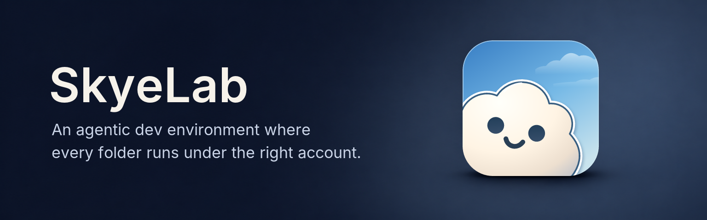

<p align="center">
  
</p>

<p align="center">
  <a href="README.md">English</a> ·
  <a href="README.zh-CN.md">简体中文</a> ·
  <a href="README.zh-TW.md">繁體中文</a> ·
  <a href="README.ja.md">日本語</a> ·
  <a href="README.ko.md">한국어</a> ·
  <a href="README.es.md">Español</a> ·
  <b>Português (Brasil)</b> ·
  <a href="README.de.md">Deutsch</a> ·
  <a href="README.fr.md">Français</a> ·
  <a href="README.ru.md">Русский</a>
</p>

> Esta é uma tradução. O [README em inglês](README.md) é a fonte da verdade; última sincronização: 2026-11-25.

<p align="center">
  <b>Um app desktop nativo para rodar agentes de programação, em que cada pasta fica presa a uma única conta.</b>
</p>

<p align="center">
  <a href="https://github.com/OpenSkye-Labs/skyelab/actions/workflows/ci.yml"></a>
  <a href="https://github.com/OpenSkye-Labs/skyelab/releases"></a>
  <a href="LICENSE"></a>
</p>

O SkyeLab é um ambiente de desenvolvimento agêntico (ADE) escrito em Rust com [GPUI](https://www.gpui.rs/). Você roda
agentes do Claude Code e do Codex em threads sobre seus projetos, revisa o que eles mudam e mantém um terminal, um
navegador e seus simuladores ao lado deles. O formato geral vem do [T3 Code](https://github.com/pingdotgg/t3code).

> **Status: inicial.** Espere arestas e mudanças incompatíveis. O macOS é a plataforma principal.

## Por que existe

Se você tem uma conta de trabalho e uma pessoal, mais cedo ou mais tarde um agente roda na conta errada. O SkyeLab
torna isso impossível: **cada pasta é vinculada a exatamente uma conta (Claude ou Codex), e esse vínculo é garantido.**

- O agente no repositório do trabalho sempre roda na conta de trabalho; o do seu projeto paralelo, na sua conta pessoal.
- O vínculo mais profundo vence, então `~/work` pode ser uma conta e `~/work/oss-fork` outra.
- Uma pasta sem vínculo nunca recorre a uma conta padrão. O SkyeLab pede que você a vincule primeiro.
- Se um caminho vinculado passar a apontar para outro lugar (um link simbólico trocado, uma pasta movida), o vínculo
  fica *stale* (desatualizado) e nenhum agente inicia ali até você confirmá-lo de novo.
- O GitHub funciona do mesmo jeito: cada conta pode ter seu próprio login do `gh`, usado para commits, pushes e pull requests.

## Recursos

- **Threads** para Claude Code e Codex, com uma timeline completa: respostas e raciocínio em streaming, cards de
  ferramentas, diffs inline, saída do shell, listas de tarefas, subagentes, perguntas, planos e aprovações de
  ferramentas que você responde ali mesmo.
- **Compositor** com menções a arquivos, threads e pull requests como chips inline, imagens e arquivos, comandos `/`,
  seletor de modelo e de esforço, um modo de permissão por thread, uma fila enquanto o agente trabalha e ditado no macOS.
- **Revisar e entregar**: um painel Changes com comentários por linha, checkpoints por turno e retrocesso, worktrees
  por thread, branches, commit, push e pull requests com o login do GitHub de cada conta.
- **Paleta de comandos** (<kbd>⌘K</kbd>) para executar qualquer ação, trocar de projeto ou abrir uma thread (também
  encontrada pelas mensagens); <kbd>⌘P</kbd> encontra um arquivo. Todo atalho pode ser remapeado.
- **Ferramentas laterais**: um terminal embutido com divisões, um painel de navegador que os agentes podem controlar
  e uma central de dispositivos para simuladores iOS e emuladores Android.
- **Muitas threads ao mesmo tempo**: uma lista única para todos os projetos, tarefas agendadas, chats paralelos, envio
  de um prompt para vários modelos e agentes que iniciam e controlam outras threads (apenas na mesma conta).
- **Suas máquinas**: compartilhe uma máquina na sua tailnet do Tailscale e rode threads nela a partir de outra. Um
  cliente móvel está em desenvolvimento.
- **Boas-vindas, temas e atualizações**: um guia de primeira execução que importa suas pastas de agentes existentes,
  cinco temas com versões clara e escura, e atualizações dentro do app conferidas com a lista SHA-256 da versão.

O [guia do usuário](docs/user-guide.md) cobre cada um em detalhes.

## Capturas de tela

<picture>
  <source media="(prefers-color-scheme: dark)" srcset="docs/images/thread-dark.png">
  
</picture>

| | |
|---|---|
| <picture><source media="(prefers-color-scheme: dark)" srcset="docs/images/composer-dark.png"></picture> | <picture><source media="(prefers-color-scheme: dark)" srcset="docs/images/palette-dark.png"></picture> |
| O compositor, com chips de menção e o seletor de modelo | A paleta de comandos |
| <picture><source media="(prefers-color-scheme: dark)" srcset="docs/images/onboarding-dark.png"></picture> | <picture><source media="(prefers-color-scheme: dark)" srcset="docs/images/themes-dark.png"></picture> |
| Boas-vindas da primeira execução | Settings → Appearance |

## Instalação

Baixe a versão mais recente na [página de releases](https://github.com/OpenSkye-Labs/skyelab/releases):

| Plataforma | Arquivo |
|---|---|
| macOS 14+ (Apple silicon) | `SkyeLab_<version>_aarch64.dmg`: abra e arraste o SkyeLab para Applications. |
| Windows (x64) | `skyelab_<version>_x64-setup.exe` |
| Linux (x86_64) | `skyelab_<version>_amd64.deb` (`sudo apt install ./skyelab_<version>_amd64.deb`) ou `skyelab_<version>_x86_64.AppImage` (`chmod +x` e depois execute) |

**Primeira abertura no macOS.** As versões ainda não são notarizadas, então o Gatekeeper bloqueia a primeira abertura.
Abra o SkyeLab uma vez, depois vá em System Settings → Privacy & Security e clique em **Open Anyway**. O Windows
SmartScreen também pode perguntar (**More info** → **Run anyway**). Depois disso, **Check for Updates** no app o mantém atualizado.

O SkyeLab não instala os agentes. Instale o [Claude Code](https://docs.claude.com/en/docs/claude-code) (`claude`),
a [CLI do Codex](https://github.com/openai/codex) (`codex`) se você usa o Codex, e a
[CLI do GitHub](https://cli.github.com) (`gh`) para pushes e pull requests.

Na primeira execução, as boas-vindas encontram suas pastas `~/.claude*` e `~/.codex*` existentes, as adicionam como
contas e importam os projetos em que os agentes delas trabalharam, cada um na conta que você confirmar.
[Primeiros passos](docs/getting-started.md) explica o resto e ajuda se você está vindo do T3 Code.

## Compilar a partir do código-fonte

Você precisa da versão estável mais recente do Rust ([rustup](https://rustup.rs)); o `rust-toolchain.toml` a seleciona.

- **macOS 14+:** Xcode completo mais o toolchain do Metal (`xcodebuild -downloadComponent MetalToolchain`). Sem ele,
  a compilação falha com "metal shader compilation failed".
- **Linux:** `libxkbcommon-x11-dev libwayland-dev libx11-xcb-dev libvulkan1 libfontconfig-dev clang cmake libwebkit2gtk-4.1-dev libgtk-3-dev`
- **Windows:** o toolchain MSVC.

```sh
cargo run -p skyelab-app                              # run a debug build
cargo install cargo-packager --locked                 # or build the macOS app and disk image:
cargo packager --release -p skyelab-app -f app,dmg    # writes target/release/SkyeLab.app and a .dmg
```

## Documentação

- [Primeiros passos](docs/getting-started.md): instalação, contas, vínculos, importação de sessões, o fluxo do dia a dia.
- [Configuração diária, vindo do T3 Code](docs/user-guide-daily-setup.md): uma lista curta para trazer seu trabalho diário.
- [Guia do usuário](docs/user-guide.md): cada recurso, página por página.
- [Modelo de segurança](docs/security.md): o que o SkyeLab garante e como.
- [Arquitetura](docs/architecture.md): crates, o daemon dentro do processo, decisões e roadmap.
- [Mobile](docs/mobile.md): o cliente iOS e Android.
- [Changelog](CHANGELOG.md)

| Plataforma | Status |
|---|---|
| macOS 14+ (Apple silicon) | Principal. Usado e testado diariamente. |
| Windows, Linux | Compilado e testado na CI. Menos testado manualmente. |
| iOS, Android | Cliente remoto em desenvolvimento em [`mobile/`](mobile). |

## Contribuindo

Contribuições são bem-vindas. O [CONTRIBUTING.md](CONTRIBUTING.md) cobre a configuração, as verificações que toda
mudança precisa passar, como testar mudanças de UI sem suas contas reais e [como atualizar os READMEs traduzidos](CONTRIBUTING.md#translated-readmes).
Siga o [Código de Conduta](CODE_OF_CONDUCT.md). Dúvidas vão para as
[Discussions](https://github.com/OpenSkye-Labs/skyelab/discussions).

## Segurança

Encontrou um problema de segurança? Reporte em particular, como o [SECURITY.md](SECURITY.md) descreve. Não abra uma issue pública.

## Licença

[MIT](LICENSE). Crédito ao [T3 Code](https://github.com/pingdotgg/t3code) (MIT) pelo design que este projeto segue.
