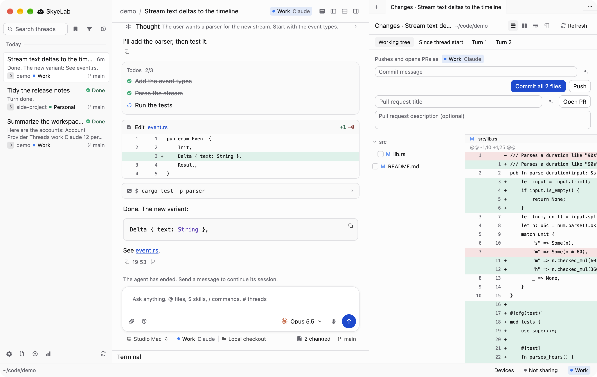

<p align="center">
  
</p>

<p align="center">
  <a href="README.md">English</a> ·
  <a href="README.zh-CN.md">简体中文</a> ·
  <a href="README.zh-TW.md">繁體中文</a> ·
  <a href="README.ja.md">日本語</a> ·
  <a href="README.ko.md">한국어</a> ·
  <a href="README.es.md">Español</a> ·
  <a href="README.pt-BR.md">Português (Brasil)</a> ·
  <a href="README.de.md">Deutsch</a> ·
  <a href="README.fr.md">Français</a> ·
  <b>Русский</b>
</p>

> Это перевод. Основной версией считается [английский README](README.md); последняя сверка с ним: 2026-11-25.

<p align="center">
  <b>Нативное десктопное приложение для запуска агентов-программистов, в котором каждая папка закреплена за одним аккаунтом.</b>
</p>

<p align="center">
  <a href="https://github.com/OpenSkye-Labs/skyelab/actions/workflows/ci.yml"></a>
  <a href="https://github.com/OpenSkye-Labs/skyelab/releases"></a>
  <a href="LICENSE"></a>
</p>

SkyeLab — среда агентной разработки (ADE), написанная на Rust с [GPUI](https://www.gpui.rs/). Вы запускаете агентов
Claude Code и Codex в тредах поверх своих проектов, проверяете их изменения и держите рядом терминал, браузер и
симуляторы. Общую форму приложение берёт у [T3 Code](https://github.com/pingdotgg/t3code).

> **Статус: ранний.** Ждите шероховатостей и несовместимых изменений. Основная платформа — macOS.

## Зачем это нужно

Если у вас есть рабочий и личный аккаунты, рано или поздно агент запустится не в том. SkyeLab делает это
невозможным: **каждая папка привязана ровно к одному аккаунту (Claude или Codex), и эта привязка соблюдается
принудительно.**

- Агент в рабочем репозитории всегда работает под рабочим аккаунтом, а в вашем личном проекте — под личным.
- Побеждает самая глубокая привязка, поэтому `~/work` может быть одним аккаунтом, а `~/work/oss-fork` — другим.
- Папка без привязки никогда не откатывается на аккаунт по умолчанию. SkyeLab сначала попросит её привязать.
- Если привязанный путь позже начинает указывать в другое место (подменили симлинк, перенесли папку), привязка
  становится *устаревшей*, и агент там не запустится, пока вы не подтвердите её снова.
- С GitHub то же самое: у каждого аккаунта может быть свой вход в `gh`, который используется для коммитов, пушей и
  pull request'ов.

## Возможности

- **Треды** для Claude Code и Codex с подробной лентой: потоковые ответы и размышления, карточки инструментов,
  встроенные диффы, вывод shell, списки задач, субагенты, вопросы, планы и разрешения на инструменты, на которые вы
  отвечаете прямо на месте.
- **Composer** с упоминаниями файлов, тредов и pull request'ов в виде встроенных чипов, изображениями и файлами,
  командами `/`, выбором модели и уровня усилий, режимом разрешений для каждого треда, очередью, пока агент работает,
  и диктовкой на macOS.
- **Ревью и выпуск**: панель Changes с комментариями к строкам, чекпоинты на каждом ходе и откат, отдельный worktree
  для каждого треда, ветки, коммит, пуш и pull request'ы со своим входом в GitHub для каждого аккаунта.
- **Палитра команд** (<kbd>⌘K</kbd>), чтобы выполнить любое действие, сменить проект или открыть тред (его можно найти
  и по сообщениям); <kbd>⌘P</kbd> ищет файл. Любое сочетание клавиш можно переназначить.
- **Инструменты сбоку**: встроенный терминал с разделением, панель браузера, которой могут управлять агенты, и хаб
  устройств для симуляторов iOS и эмуляторов Android.
- **Много тредов сразу**: один список по всем проектам, запланированные задачи, побочные чаты, отправка одного промпта
  нескольким моделям и агенты, которые запускают другие треды и управляют ими (только в пределах того же аккаунта).
- **Ваши машины**: откройте доступ к машине через свой tailnet в Tailscale и запускайте на ней треды с другой машины.
  Мобильный клиент в разработке.
- **Онбординг, темы и обновления**: руководство при первом запуске, которое импортирует ваши существующие папки
  агентов, пять тем со светлым и тёмным вариантами и обновления внутри приложения, сверяемые со списком SHA-256 релиза.

[Руководство пользователя](docs/user-guide.md) подробно описывает каждую из этих возможностей.

## Скриншоты

<picture>
  <source media="(prefers-color-scheme: dark)" srcset="docs/images/thread-dark.png">
  
</picture>

| | |
|---|---|
| <picture><source media="(prefers-color-scheme: dark)" srcset="docs/images/composer-dark.png"></picture> | <picture><source media="(prefers-color-scheme: dark)" srcset="docs/images/palette-dark.png"></picture> |
| Composer с чипами упоминаний и выбором модели | Палитра команд |
| <picture><source media="(prefers-color-scheme: dark)" srcset="docs/images/onboarding-dark.png"></picture> | <picture><source media="(prefers-color-scheme: dark)" srcset="docs/images/themes-dark.png"></picture> |
| Онбординг при первом запуске | Settings → Appearance |

## Установка

Скачайте последнюю сборку со [страницы релизов](https://github.com/OpenSkye-Labs/skyelab/releases):

| Платформа | Файл |
|---|---|
| macOS 14+ (Apple silicon) | `SkyeLab_<version>_aarch64.dmg`: откройте его и перетащите SkyeLab в «Программы». |
| Windows (x64) | `skyelab_<version>_x64-setup.exe` |
| Linux (x86_64) | `skyelab_<version>_amd64.deb` (`sudo apt install ./skyelab_<version>_amd64.deb`) или `skyelab_<version>_x86_64.AppImage` (`chmod +x`, затем запустите) |

**Первый запуск на macOS.** Релизные сборки пока не нотаризованы, поэтому Gatekeeper блокирует первый запуск.
Откройте SkyeLab один раз, затем перейдите в Системные настройки → Конфиденциальность и безопасность и нажмите
**Open Anyway**. Windows SmartScreen тоже может спросить (**More info** → **Run anyway**). После этого
**Check for Updates** в приложении будет поддерживать его в актуальном состоянии.

SkyeLab не устанавливает агентов. Установите [Claude Code](https://docs.claude.com/en/docs/claude-code) (`claude`),
[Codex CLI](https://github.com/openai/codex) (`codex`), если пользуетесь Codex, и
[GitHub CLI](https://cli.github.com) (`gh`) для пушей и pull request'ов.

При первом запуске онбординг находит ваши существующие папки `~/.claude*` и `~/.codex*`, добавляет их как аккаунты и
импортирует проекты, в которых работали их агенты, каждый под тем аккаунтом, который вы подтвердите.
[Getting started](docs/getting-started.md) объясняет остальное и поможет, если вы переходите с T3 Code.

## Сборка из исходников

Нужен последний стабильный Rust ([rustup](https://rustup.rs)); `rust-toolchain.toml` выберет его сам.

- **macOS 14+:** полный Xcode и тулчейн Metal (`xcodebuild -downloadComponent MetalToolchain`). Без него сборка
  падает с ошибкой "metal shader compilation failed".
- **Linux:** `libxkbcommon-x11-dev libwayland-dev libx11-xcb-dev libvulkan1 libfontconfig-dev clang cmake libwebkit2gtk-4.1-dev libgtk-3-dev`
- **Windows:** тулчейн MSVC.

```sh
cargo run -p skyelab-app                              # run a debug build
cargo install cargo-packager --locked                 # or build the macOS app and disk image:
cargo packager --release -p skyelab-app -f app,dmg    # writes target/release/SkyeLab.app and a .dmg
```

## Документация

- [Getting started](docs/getting-started.md): установка, аккаунты, привязки, импорт сессий, повседневная работа.
- [Руководство пользователя](docs/user-guide.md): все возможности, страница за страницей.
- [Модель безопасности](docs/security.md): что гарантирует SkyeLab и как.
- [Архитектура](docs/architecture.md): крейты, встроенный в процесс демон, решения и планы развития.
- [Мобильный клиент](docs/mobile.md): клиент для iOS и Android.
- [Changelog](CHANGELOG.md)

| Платформа | Статус |
|---|---|
| macOS 14+ (Apple silicon) | Основная. Используется и тестируется ежедневно. |
| Windows, Linux | Собираются и тестируются в CI. Вручную тестируются меньше. |
| iOS, Android | Удалённый клиент в разработке в [`mobile/`](mobile). |

## Участие в разработке

Мы рады вкладу. [CONTRIBUTING.md](CONTRIBUTING.md) описывает настройку окружения, проверки, которые должно проходить
каждое изменение, как тестировать изменения интерфейса без ваших настоящих аккаунтов и [как обновлять переведённые
README](CONTRIBUTING.md#translated-readmes). Пожалуйста, соблюдайте [Code of Conduct](CODE_OF_CONDUCT.md). Вопросы
задавайте в [Discussions](https://github.com/OpenSkye-Labs/skyelab/discussions).

## Безопасность

Нашли проблему с безопасностью? Сообщите о ней приватно, как описано в [SECURITY.md](SECURITY.md). Не открывайте
публичный issue.

## Лицензия

[MIT](LICENSE). Спасибо [T3 Code](https://github.com/pingdotgg/t3code) (MIT) за дизайн, на который опирается этот проект.
