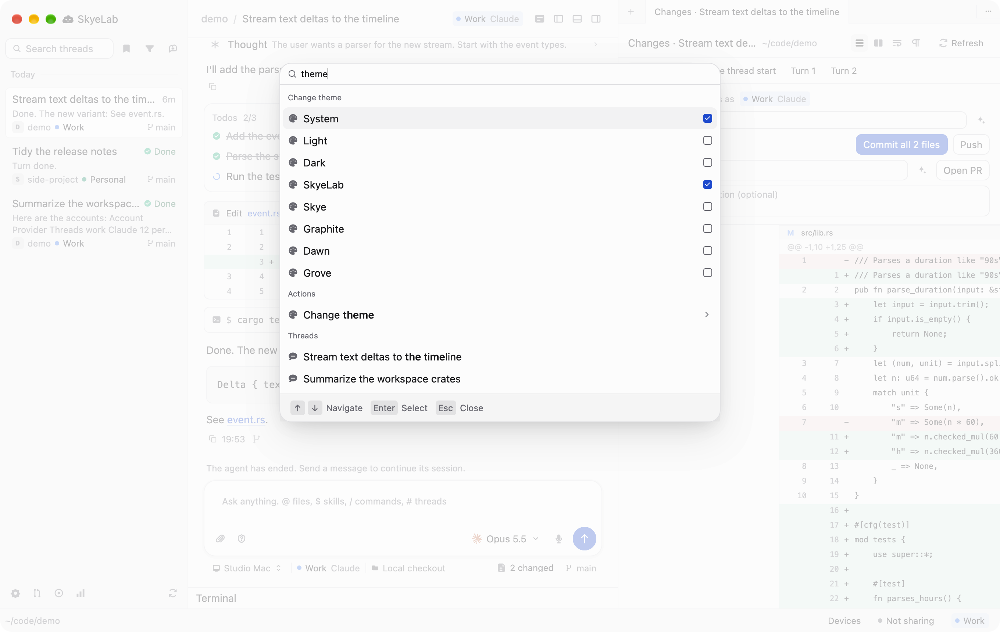

<p align="center">
  
</p>

<p align="center">
  <a href="README.md">English</a> ·
  <b>简体中文</b> ·
  <a href="README.zh-TW.md">繁體中文</a> ·
  <a href="README.ja.md">日本語</a> ·
  <a href="README.ko.md">한국어</a> ·
  <a href="README.es.md">Español</a> ·
  <a href="README.pt-BR.md">Português (Brasil)</a> ·
  <a href="README.de.md">Deutsch</a> ·
  <a href="README.fr.md">Français</a> ·
  <a href="README.ru.md">Русский</a>
</p>

> 本文为译文，以 [英文 README](README.md) 为准。最后一次与英文版同步：2026-11-25。

<p align="center">
  <b>一款用来运行编程智能体的原生桌面应用，每个文件夹都锁定到一个账号。</b>
</p>

<p align="center">
  <a href="https://github.com/OpenSkye-Labs/skyelab/actions/workflows/ci.yml"></a>
  <a href="https://github.com/OpenSkye-Labs/skyelab/releases"></a>
  <a href="LICENSE"></a>
</p>

SkyeLab 是一个用 Rust 和 [GPUI](https://www.gpui.rs/) 编写的智能体开发环境（ADE）。你可以在项目上以线程的形式运行
Claude Code 和 Codex 智能体，审查它们做出的改动，并把终端、浏览器和模拟器放在它们旁边。它的整体形态参考了
[T3 Code](https://github.com/pingdotgg/t3code)。

> **状态：早期。** 难免有粗糙之处和破坏性变更。macOS 是主要平台。

## 为什么要做它

如果你同时有工作账号和个人账号，迟早会有智能体在错误的账号下运行。SkyeLab 让这种事不可能发生：
**每个文件夹都绑定到恰好一个账号（Claude 或 Codex），并且这个绑定是强制执行的。**

- 工作仓库里的智能体总是用工作账号运行；业余项目里的则用你的个人账号。
- 最深的绑定优先，所以 `~/work` 可以是一个账号，`~/work/oss-fork` 是另一个。
- 没有绑定的文件夹绝不会回退到默认账号。SkyeLab 会先请你绑定它。
- 如果某个已绑定的路径后来指向了别处（符号链接被替换、文件夹被移动），这个绑定就会变为*失效*，在你重新确认之前，
  那里不会启动任何智能体。
- GitHub 也是同样的方式：每个账号可以有自己的 `gh` 登录，用于提交、推送和拉取请求。

## 功能

- **线程**：支持 Claude Code 和 Codex，配有丰富的时间线：流式输出的回复和思考过程、工具卡片、内联 diff、
  shell 输出、待办列表、子智能体，以及可以就地回答的问题、计划和工具审批。
- **输入框**：文件、线程和拉取请求的提及会显示为内联标签，支持图片和文件、`/` 命令、模型和推理强度选择器、
  每个线程独立的权限模式、智能体工作时的消息队列，以及 macOS 上的语音听写。
- **审查与发布**：带行内评论的 Changes 面板、每轮的检查点与回退、每个线程独立的 worktree、分支、提交、推送和
  拉取请求，全部使用各账号自己的 GitHub 登录。
- **命令面板**（<kbd>⌘K</kbd>）：执行任何操作、切换项目或打开线程（也能按消息内容找到线程）；<kbd>⌘P</kbd>
  查找文件。所有快捷键都可以重新绑定。
- **辅助工具**：支持分屏的内嵌终端、可由智能体操控的浏览器面板，以及用于 iOS 模拟器和 Android 模拟器的设备中心。
- **多线程并行**：跨项目的统一列表、定时任务、旁路聊天、把同一个提示发给多个模型，以及能启动并驱动其他线程的
  智能体（仅限同一账号）。
- **你的机器**：通过 Tailscale tailnet 共享一台机器，并从另一台机器在它上面运行线程。移动客户端正在开发中。
- **引导、主题与更新**：首次运行时的引导会导入你已有的智能体文件夹；五套主题，各有浅色和深色版本；应用内更新会
  对照发布版本的 SHA-256 列表进行校验。

[用户指南](docs/user-guide.md) 对以上每一项都有完整说明。

## 截图

<picture>
  <source media="(prefers-color-scheme: dark)" srcset="docs/images/thread-dark.png">
  
</picture>

| | |
|---|---|
| <picture><source media="(prefers-color-scheme: dark)" srcset="docs/images/composer-dark.png"></picture> | <picture><source media="(prefers-color-scheme: dark)" srcset="docs/images/palette-dark.png"></picture> |
| 输入框，带有提及标签和模型选择器 | 命令面板 |
| <picture><source media="(prefers-color-scheme: dark)" srcset="docs/images/onboarding-dark.png"></picture> | <picture><source media="(prefers-color-scheme: dark)" srcset="docs/images/themes-dark.png"></picture> |
| 首次运行引导 | Settings → Appearance |

## 安装

从 [发布页面](https://github.com/OpenSkye-Labs/skyelab/releases) 下载最新版本：

| 平台 | 文件 |
|---|---|
| macOS 14+（Apple 芯片） | `SkyeLab_0.1.1_aarch64.dmg`：打开后把 SkyeLab 拖到“应用程序”文件夹。 |
| Windows（x64） | `skyelab_0.1.1_x64-setup.exe` |
| Linux（x86_64） | `skyelab_0.1.1_amd64.deb`（`sudo apt install ./skyelab_0.1.1_amd64.deb`）或 `skyelab_0.1.1_x86_64.AppImage`（先 `chmod +x`，再运行） |

**在 macOS 上首次打开。** 发布版本目前还没有经过公证，所以 Gatekeeper 会阻止首次打开。先打开一次 SkyeLab，
然后前往“系统设置”→“隐私与安全性”，点击 **Open Anyway**（仍要打开）。Windows SmartScreen 也可能会询问
（**More info** → **Run anyway**）。之后，应用内的 **Check for Updates** 会让它保持最新。

SkyeLab 不会安装智能体。请自行安装 [Claude Code](https://docs.claude.com/en/docs/claude-code)（`claude`），
如果使用 Codex 还需安装 [Codex CLI](https://github.com/openai/codex)（`codex`），推送和拉取请求则需要
[GitHub CLI](https://cli.github.com)（`gh`）。

首次启动时，引导程序会找到你已有的 `~/.claude*` 和 `~/.codex*` 文件夹，把它们添加为账号，并导入这些智能体工作过的
项目，每个项目都使用你确认的账号。[入门指南](docs/getting-started.md) 会带你完成其余步骤，如果你是从 T3 Code
迁移过来，它也能帮上忙。

## 从源码构建

你需要最新的稳定版 Rust（[rustup](https://rustup.rs)）；`rust-toolchain.toml` 会自动选用它。

- **macOS 14+：** 完整的 Xcode 以及 Metal 工具链（`xcodebuild -downloadComponent MetalToolchain`）。缺少它时，
  构建会失败并提示 "metal shader compilation failed"。
- **Linux：** `libxkbcommon-x11-dev libwayland-dev libx11-xcb-dev libvulkan1 libfontconfig-dev clang cmake libwebkit2gtk-4.1-dev libgtk-3-dev`
- **Windows：** MSVC 工具链。

```sh
cargo run -p skyelab-app                              # run a debug build
cargo install cargo-packager --locked                 # or build the macOS app and disk image:
cargo packager --release -p skyelab-app -f app,dmg    # writes target/release/SkyeLab.app and a .dmg
```

## 文档

- [入门指南](docs/getting-started.md)：安装、账号、绑定、导入会话，以及日常工作流程。
- [用户指南](docs/user-guide.md)：所有功能，逐页说明。
- [安全模型](docs/security.md)：SkyeLab 保证了什么，以及如何保证。
- [架构](docs/architecture.md)：crate、进程内守护进程、设计决策和路线图。
- [移动端](docs/mobile.md)：iOS 和 Android 客户端。
- [更新日志](CHANGELOG.md)

| 平台 | 状态 |
|---|---|
| macOS 14+（Apple 芯片） | 主要平台。每天使用和测试。 |
| Windows、Linux | 在 CI 中构建和测试。手动测试较少。 |
| iOS、Android | 远程客户端正在 [`mobile/`](mobile) 下开发。 |

## 参与贡献

欢迎贡献。[CONTRIBUTING.md](CONTRIBUTING.md) 介绍了环境搭建、每个改动必须通过的检查、如何在不使用真实账号的情况下
测试 UI 改动，以及 [如何更新翻译版 README](CONTRIBUTING.md#translated-readmes)。请遵守
[行为准则](CODE_OF_CONDUCT.md)。有问题请到
[Discussions](https://github.com/OpenSkye-Labs/skyelab/discussions) 提出。

## 安全

发现了安全问题？请按 [SECURITY.md](SECURITY.md) 的说明私下报告，不要公开提 issue。

## 许可证

[MIT](LICENSE)。感谢 [T3 Code](https://github.com/pingdotgg/t3code)（MIT）提供了本项目所沿用的设计。
