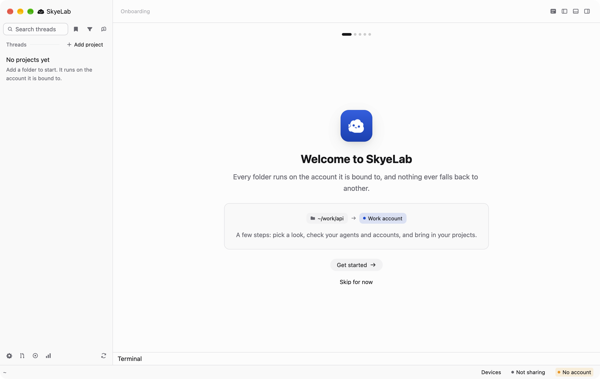

<p align="center">
  
</p>

<p align="center">
  <a href="README.md">English</a> ·
  <a href="README.zh-CN.md">简体中文</a> ·
  <b>繁體中文</b> ·
  <a href="README.ja.md">日本語</a> ·
  <a href="README.ko.md">한국어</a> ·
  <a href="README.es.md">Español</a> ·
  <a href="README.pt-BR.md">Português (Brasil)</a> ·
  <a href="README.de.md">Deutsch</a> ·
  <a href="README.fr.md">Français</a> ·
  <a href="README.ru.md">Русский</a>
</p>

> 本文為譯文，以 [英文 README](README.md) 為準。最後一次與英文版同步：2026-11-25。

<p align="center">
  <b>一款用來執行程式設計代理的原生桌面應用程式，每個資料夾都鎖定到一個帳號。</b>
</p>

<p align="center">
  <a href="https://github.com/OpenSkye-Labs/skyelab/actions/workflows/ci.yml"></a>
  <a href="https://github.com/OpenSkye-Labs/skyelab/releases"></a>
  <a href="LICENSE"></a>
</p>

SkyeLab 是以 Rust 和 [GPUI](https://www.gpui.rs/) 撰寫的代理開發環境（ADE）。你可以在專案上以討論串的形式執行
Claude Code 和 Codex 代理，檢閱它們做出的變更，並把終端機、瀏覽器和模擬器放在旁邊。它的整體樣貌參考了
[T3 Code](https://github.com/pingdotgg/t3code)。

> **狀態：早期。** 難免有不完善之處和破壞性變更。macOS 是主要平台。

## 為什麼要做它

如果你同時有工作帳號和個人帳號，遲早會有代理在錯誤的帳號下執行。SkyeLab 讓這種事不可能發生：
**每個資料夾都綁定到恰好一個帳號（Claude 或 Codex），而且這個綁定會被強制執行。**

- 工作儲存庫裡的代理一律用工作帳號執行；個人專案裡的則用你的個人帳號。
- 最深層的綁定優先，所以 `~/work` 可以是一個帳號，`~/work/oss-fork` 是另一個。
- 沒有綁定的資料夾絕不會退回預設帳號。SkyeLab 會先請你綁定它。
- 如果某個已綁定的路徑之後指向別處（符號連結被替換、資料夾被搬移），這個綁定就會變成*失效*，在你重新確認之前，
  那裡不會啟動任何代理。
- GitHub 也是同樣的方式：每個帳號可以有自己的 `gh` 登入，用於提交、推送和拉取請求（PR）。

## 功能

- **討論串**：支援 Claude Code 和 Codex，搭配豐富的時間軸：串流顯示的回覆與思考過程、工具卡片、行內 diff、
  shell 輸出、待辦清單、子代理，以及可以就地回答的問題、計畫和工具核准。
- **輸入框**：檔案、討論串和 PR 的提及會顯示為行內標籤，支援圖片和檔案、`/` 指令、模型與推理強度選擇器、
  每個討論串各自的權限模式、代理工作時的訊息佇列，以及 macOS 上的語音聽寫。
- **檢閱與發布**：附逐行留言的 Changes 面板、每一輪的檢查點與倒回、每個討論串各自的 worktree、分支、提交、推送和
  PR，全部使用各帳號自己的 GitHub 登入。
- **命令面板**（<kbd>⌘K</kbd>）：執行任何動作、切換專案或開啟討論串（也能依訊息內容找到）；<kbd>⌘P</kbd>
  尋找檔案。所有快捷鍵都可以重新指定。
- **輔助工具**：支援分割的內嵌終端機、可由代理操控的瀏覽器面板，以及用於 iOS 模擬器和 Android 模擬器的裝置中心。
- **同時處理多個討論串**：跨專案的單一清單、排程工作、側邊對話、把同一個提示傳給多個模型，以及能啟動並操控其他
  討論串的代理（僅限同一帳號）。
- **你的機器**：透過 Tailscale tailnet 分享一台機器，並從另一台機器在它上面執行討論串。行動版用戶端正在開發中。
- **新手引導、主題與更新**：首次執行的引導會匯入你既有的代理資料夾；五套主題，各有淺色與深色版本；應用程式內更新會
  比對發行版本的 SHA-256 清單進行驗證。

[使用者指南](docs/user-guide.md) 對以上每一項都有完整說明。

## 螢幕截圖

<picture>
  <source media="(prefers-color-scheme: dark)" srcset="docs/images/thread-dark.png">
  
</picture>

| | |
|---|---|
| <picture><source media="(prefers-color-scheme: dark)" srcset="docs/images/composer-dark.png"></picture> | <picture><source media="(prefers-color-scheme: dark)" srcset="docs/images/palette-dark.png"></picture> |
| 輸入框，附有提及標籤和模型選擇器 | 命令面板 |
| <picture><source media="(prefers-color-scheme: dark)" srcset="docs/images/onboarding-dark.png"></picture> | <picture><source media="(prefers-color-scheme: dark)" srcset="docs/images/themes-dark.png"></picture> |
| 首次執行的新手引導 | Settings → Appearance |

## 安裝

從 [發行頁面](https://github.com/OpenSkye-Labs/skyelab/releases) 下載最新版本：

| 平台 | 檔案 |
|---|---|
| macOS 14+（Apple 晶片） | `SkyeLab_<version>_aarch64.dmg`：開啟後把 SkyeLab 拖到「應用程式」資料夾。 |
| Windows（x64） | `skyelab_<version>_x64-setup.exe` |
| Linux（x86_64） | `skyelab_<version>_amd64.deb`（`sudo apt install ./skyelab_<version>_amd64.deb`）或 `skyelab_<version>_x86_64.AppImage`（先 `chmod +x`，再執行） |

**在 macOS 上首次開啟。** 發行版本目前尚未經過公證，所以 Gatekeeper 會阻擋首次開啟。先開啟一次 SkyeLab，
然後前往「系統設定」→「隱私權與安全性」，按一下 **Open Anyway**（強制打開）。Windows SmartScreen 也可能會詢問
（**More info** → **Run anyway**）。之後，應用程式內的 **Check for Updates** 會讓它保持最新。

SkyeLab 不會安裝代理。請自行安裝 [Claude Code](https://docs.claude.com/en/docs/claude-code)（`claude`），
若使用 Codex 也請安裝 [Codex CLI](https://github.com/openai/codex)（`codex`），推送和 PR 則需要
[GitHub CLI](https://cli.github.com)（`gh`）。

首次啟動時，新手引導會找到你既有的 `~/.claude*` 和 `~/.codex*` 資料夾，把它們加入為帳號，並匯入這些代理工作過的
專案，每個專案都使用你確認的帳號。[入門指南](docs/getting-started.md) 會帶你完成其餘步驟，如果你是從 T3 Code
轉過來，它也能幫上忙。

## 從原始碼建置

你需要最新的穩定版 Rust（[rustup](https://rustup.rs)）；`rust-toolchain.toml` 會自動選用它。

- **macOS 14+：** 完整的 Xcode 以及 Metal 工具鏈（`xcodebuild -downloadComponent MetalToolchain`）。少了它，
  建置會失敗並顯示 "metal shader compilation failed"。
- **Linux：** `libxkbcommon-x11-dev libwayland-dev libx11-xcb-dev libvulkan1 libfontconfig-dev clang cmake libwebkit2gtk-4.1-dev libgtk-3-dev`
- **Windows：** MSVC 工具鏈。

```sh
cargo run -p skyelab-app                              # run a debug build
cargo install cargo-packager --locked                 # or build the macOS app and disk image:
cargo packager --release -p skyelab-app -f app,dmg    # writes target/release/SkyeLab.app and a .dmg
```

## 文件

- [入門指南](docs/getting-started.md)：安裝、帳號、綁定、匯入工作階段，以及日常工作流程。
- [日常設定：從 T3 Code 遷移](docs/user-guide-daily-setup.md)：遷移日常工作的簡短清單。
- [使用者指南](docs/user-guide.md)：所有功能，逐頁說明。
- [安全模型](docs/security.md)：SkyeLab 保證了什麼，以及如何保證。
- [架構](docs/architecture.md)：crate、行程內常駐程式、設計決策和路線圖。
- [行動版](docs/mobile.md)：iOS 和 Android 用戶端。
- [更新紀錄](CHANGELOG.md)

| 平台 | 狀態 |
|---|---|
| macOS 14+（Apple 晶片） | 主要平台。每天使用和測試。 |
| Windows、Linux | 在 CI 中建置和測試。手動測試較少。 |
| iOS、Android | 遠端用戶端正在 [`mobile/`](mobile) 下開發。 |

## 參與貢獻

歡迎貢獻。[CONTRIBUTING.md](CONTRIBUTING.md) 說明了環境設定、每項變更必須通過的檢查、如何在不使用真實帳號的情況下
測試 UI 變更，以及 [如何更新翻譯版 README](CONTRIBUTING.md#translated-readmes)。請遵守
[行為準則](CODE_OF_CONDUCT.md)。有問題請到
[Discussions](https://github.com/OpenSkye-Labs/skyelab/discussions) 提出。

## 安全性

發現安全性問題？請依 [SECURITY.md](SECURITY.md) 的說明私下回報，不要公開開 issue。

## 授權

[MIT](LICENSE)。感謝 [T3 Code](https://github.com/pingdotgg/t3code)（MIT）提供本專案所沿用的設計。
