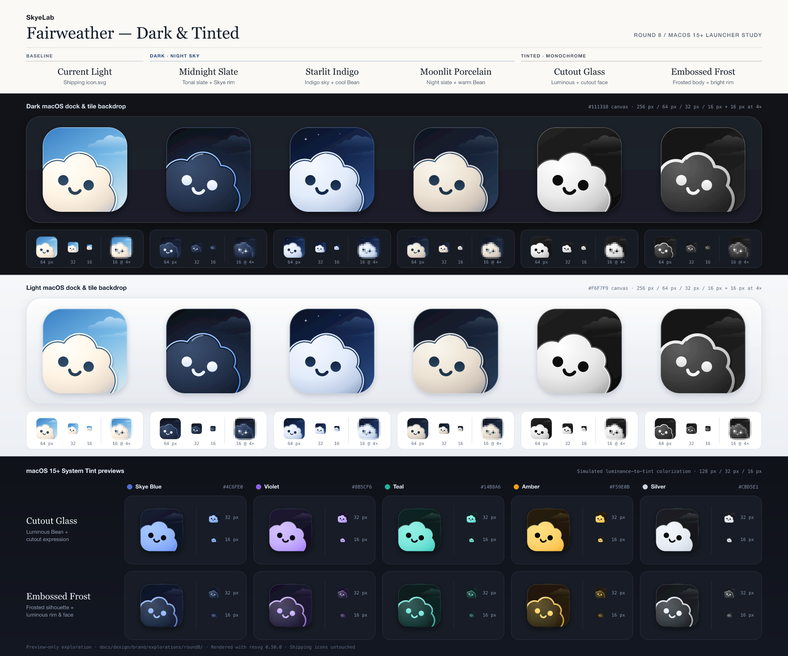

# Round 8 — macOS 15+ Dark & Tinted Launcher Icon Previews

Preview-only exploration of macOS 15+ (Sequoia+) **Dark** and **Tinted** launcher icons for SkyeLab, derived directly from the approved Fairweather Corner Peek master (`crates/skyelab-app/icons/icon.svg`). No shipping icons or packaging scripts were modified.



## Geometry preserved from Fairweather

Every SVG variant uses the exact `1024 × 1024` canvas, `824 × 824` (`rx="185"`) tile safe area, `scale(4)` coordinate space, lower-left corner crop of `#bean`, three visible cloud lobes above the eyes, `+11°` rotated eyes and tilted smile, open sky above Bean, and high-right distant cloud shelves.

## Variants

### Dark (night-sky) concepts

| File | Direction | Sky gradient | Bean surface | Contour / rim | Face (eyes / smile) |
| --- | --- | --- | --- | --- | --- |
| `dark-midnight-slate.svg` | Tonal dark slate harmonizing with SkyeLab default theme (`#111318`) and Skye blue accent | `#0D1017` → `#141C2B` → `#1F2E47` + radial glow `#4C6FE0` (26%) | `#3C5070` → `#293854` → `#1B263B` → `#131B2A` | Luminous outer rim `#B6D8FF` → `#6EA8FF` → `#4A7EE0`, inner contour `#101827`, tile rim `#96C0FF` (40%) | `#FFFFFF` → `#DCE9FA`, smile `#ECF4FF` |
| `dark-starlit-indigo.svg` | Astronomical indigo twilight sky (Skye `#101420` + storm blue) with quiet upper-sky starlight glints and cool moonlit Bean | `#0B1124` → `#162952` → `#27467C` (stars `#E6F1FF` / `#D5E8FF`) | `#F4F8FF` → `#E1EBFA` → `#C0CFE7` → `#94A8C8` | Moonlit outer rim `#ECF4FF` → `#BBD4F6`, storm-indigo contour `#26416B`, tile rim `#A8CEFF` (42%) | `#12233E` → `#213A5E`, smile `#182C4A` |
| `dark-moonlit-porcelain.svg` | Closest nocturnal sibling to Light Fairweather — calm night-slate sky with night-toned warm porcelain Bean | `#101420` → `#182438` → `#263954` | `#FAF6EE` → `#ECE2D3` → `#D0C5B9` → `#A6A3A7` | Warm pearl outer rim `#F7F3EC` → `#D4CEC7`, storm-blue contour `#2C4968`, tile rim `#CEDFF2` (36%) | `#182D44` → `#29415B`, smile `#1F344A` |

### Tinted (monochrome / adaptive) concepts

Authored in pure achromatic grayscale + alpha so macOS 15+ Tinted mode can colorize luminance cleanly across any user accent hue.

| File | Direction | Base tile | Bean surface | Contour / rim | Face expression |
| --- | --- | --- | --- | --- | --- |
| `tinted-cutout-glass.svg` | Luminous monochrome Bean with masked dark cutout eyes & smile (echoes `peek.svg` cutout clarity) | `#222222` → `#171717` → `#111111` | `#FFFFFF` → `#EAEAEA` → `#CCCCCC` → `#A6A6A6` | Frosted outer halo `#FFFFFF` (24%), inner rim `#FFFFFF` (88%), tile rim `#FFFFFF` (34% → 10%) | Transparent `<mask id="face-cutout">` letting dark tinted tile show through |
| `tinted-embossed-frost.svg` | Dark matte-frost tile with translucent embossed Bean, crisp luminous rim, and solid bright facial features | `#141414` → `#1C1C1C` → `#262626` | `#FFFFFF` (35%) → `#E8E8E8` (22%) → `#C0C0C0` (12%) → `#989898` (7%) | Embossed rim `#FFFFFF` (98%) → `#E4E4E4` (86%) → `#BDBDBD` (68%), tile rim `#FFFFFF` (38% → 12%) | `#FFFFFF` → `#E0E0E0`, smile `#F7F7F7` |

### Sample System Tint Swatches (`comparison.png`)

Both Tinted variants are previewed at `128 px`, `32 px`, and `16 px` under simulated luminance-to-tint colorization for five system tints:

- **Skye Blue** `#4C6FE0`
- **Violet** `#8B5CF6`
- **Teal** `#14B8A6`
- **Amber** `#F59E0B`
- **Silver** `#CBD5E1`

## Rendering

Rendered locally with `resvg 0.50.0` (the same renderer used by `scripts/icons.sh`):

```bash
# Render individual preview SVG at standard macOS launcher sizes
for s in 256 64 32 16; do
  resvg -w "$s" -h "$s" docs/design/brand/explorations/round8/dark-midnight-slate.svg "out-${s}.png"
done

# Composite comparison sheet (comparison.png) rendered via resvg from an assembled SVG
# embedding native 256 / 64 / 32 / 16 px rasters and nearest-neighbor 4x 16 px loupes:
resvg comparison.svg docs/design/brand/explorations/round8/comparison.png
```
